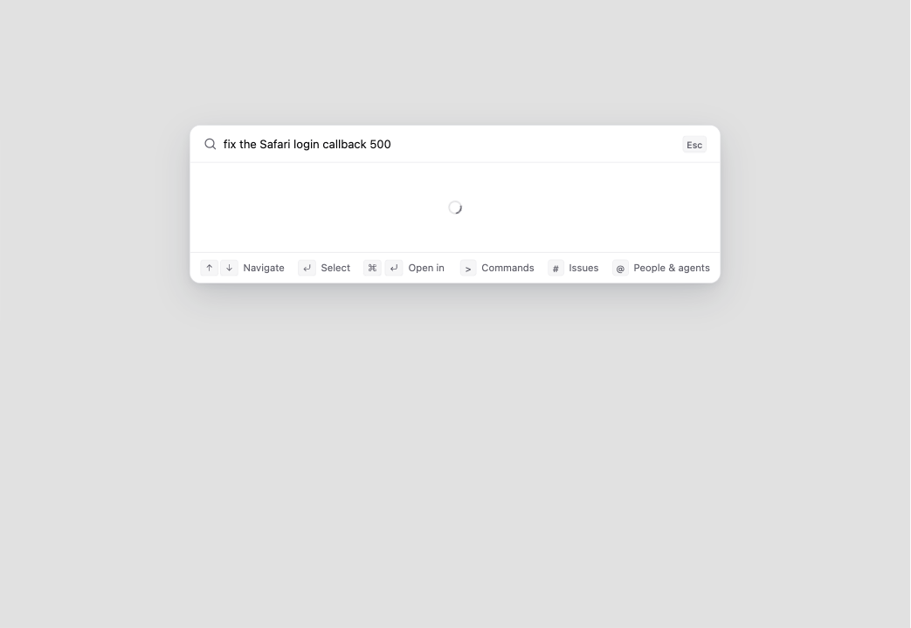
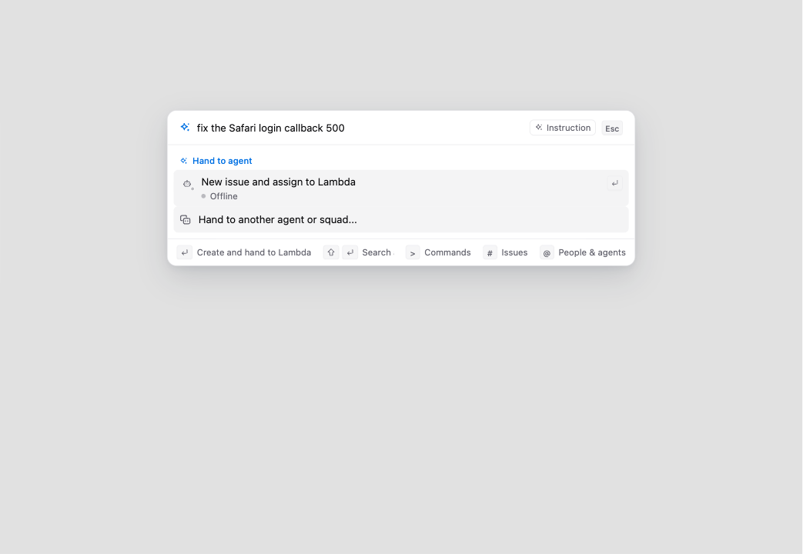

# IME Shift+Enter screenshots

These are unchanged captures of the real SearchCommand/cmdk component in Chrome 156.0.8078.80 (1100 × 760 viewport), with the real application providers and synthetic API fixture data. Keyboard input was dispatched with synthetic DOM KeyboardEvent events. This is not OS-native IME, Safari, or production backend end-to-end verification.

- Before: public base `3a0fed59f52b600ebbce1117b65c87f7d13ca492`.
- After: reviewed product head `d209b96b29acab04c9bbc50511af44fb259d7ef2`.
- Setup: enter the synthetic prompt `fix the Safari login callback 500`, select the delegation preview, start composition, then dispatch Shift+Enter.
- Before: Shift+Enter cancels the event and removes the delegation preview.
- After: the same event preserves the draft and delegation preview. After composition ends, ordinary Shift+Enter still dismisses the preview.

| Event | Before | After |
| --- | --- | --- |
| `isComposing=true`, `keyCode=13` |  |  |
| `isComposing=false`, `keyCode=229` |  |  |

The fixture prompt mentions Safari; these captures were taken in Chrome. Names and API responses shown here are synthetic fixture data.
